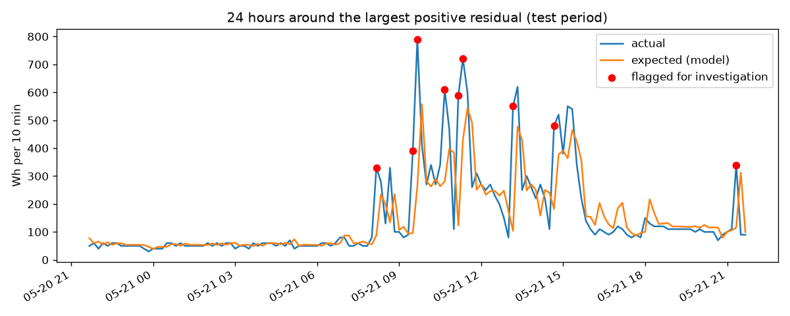

# WATTWISE

**AI energy intelligence for buildings.** WATTWISE learns a building's normal electricity-use pattern and flags periods of unexpectedly high consumption that may deserve investigation.

Veritas AI International High School Hackathon 2026 · Track: AI + Climate
Primary user: a building occupant or facilities manager

**Research question:** *Can machine learning learn normal building energy-consumption patterns well enough to detect unexpectedly high electricity usage?*

---

## How it works

```
recent usage (before time t) ──► ML model ──► expected usage at t
                                                   │
                     actual meter reading at t ────┤
                                                   ▼
                       residual = actual − expected
                                                   │
     above the top-5% threshold learned on validation data ──► "period requiring investigation"
```



## Evaluation design

| Period | Share | Dates (2016) | Used for |
|---|---|---|---|
| Train | 70% | 12 Jan – 16 Apr | fitting models |
| Validation | 15% | 16 Apr – 7 May | choosing features, model, settings **and** the anomaly threshold |
| Test | 15% | 7 May – 27 May | evaluated **once**, at the end |

The rows are never shuffled. The test period plays no part in any choice.

## Results

**Validation** (used to choose the model):

| Model | Features chosen on validation | MAE (Wh) | RMSE (Wh) |
|---|---|---|---|
| Baseline (train average, same weekday + hour) | – | 49.10 | 88.70 |
| Linear Regression | previous interval, rolling 1h mean, lights previous interval | 26.04 | 61.88 |
| Random Forest | previous interval | 26.81 | 60.89 |
| **Gradient Boosting (selected)** | previous interval, rolling 1h mean, rolling 6h mean | **25.90** | **59.44** |

**Final test** (unseen, evaluated once):

| | MAE (Wh) | RMSE (Wh) |
|---|---|---|
| Baseline | 48.69 | 86.86 |
| **Gradient Boosting** | **26.26** | **60.42** |
| Improvement over baseline | **46.1%** | **30.4%** |
| *Reference: copy previous 10-min reading (no ML)* | *26.74* | *66.84* |

- **Anomalies:** 49 test intervals were flagged, grouped into 42 periods. The threshold is a residual of at least 219 Wh, the 95th percentile of positive validation residuals.
- **Honest caveat:** the model beats the baseline by a wide margin. But most of its skill comes from the most recent reading, and simply copying that reading is almost as good on MAE (26.7 vs 26.3). The model's clearer gain is on RMSE (60.4 vs 66.8), meaning fewer very large misses. See [docs/ML_EXPLAINED.md](docs/ML_EXPLAINED.md).

An anomaly means *usage was unusually high compared with what the model expected*. It does **not** prove energy was wasted.

## Dataset

[UCI Appliances Energy Prediction](https://archive.ics.uci.edu/dataset/374/appliances+energy+prediction): appliance energy use of one low-energy house in Belgium, measured in **Wh per 10-minute interval**, Jan–May 2016 (19,735 rows). Licensed CC BY 4.0. Details are in [data/DATASET.md](data/DATASET.md).

## Repository structure

```
data/raw/            energydata_complete.csv (UCI, unchanged)
data/processed/      cleaned.csv
data/DATASET.md      source, license, units, cleaning report
ml/get_data.py       (optional) re-download the raw data
ml/prepare_data.py   step 1: clean data      → data/processed/cleaned.csv, results/data_quality.json
ml/features.py       candidate features (all use only past data)
ml/train.py          step 2: feature + model selection on validation, final test, anomalies, failure analysis
ml/wattwise.py       reusable: predict_expected_usage(), analyse_consumption()
ml/export_web.py     step 3: export the model, demo samples and golden cases for the app
model/               saved model + validation-calibrated threshold
results/             metrics.json, predictions.csv, anomalies.csv, failure_analysis.csv/.md, figures/
docs/ML_EXPLAINED.md beginner-friendly explanation
website/             the WATTWISE app (Next.js, runs the real model in the browser)
notebook/            (later)
```

## Run it

```bash
python -m venv .venv
.venv\Scripts\activate          # Windows   (macOS/Linux: source .venv/bin/activate)
pip install -r requirements.txt
python ml/prepare_data.py
python ml/train.py               # about 2 minutes
python ml/export_web.py          # model + demo + golden files for the app
```

```python
import sys; sys.path.append("ml")
import pandas as pd
from wattwise import analyse_consumption

df = pd.read_csv("data/processed/cleaned.csv", index_col="timestamp", parse_dates=True)
all_intervals, anomalies = analyse_consumption(df["2016-05-06":])
```

The first 24 hours of any input are used as history only and get no prediction.

## The WATTWISE app

A landing page with a scroll-animated fridge leads into a working app: set up your building and tariff, enter the kWh from your monthly bill plus at least three earlier bills, and WATTWISE learns your normal from your own history, predicts this month, and shows how much looks unusually high, what it may cost, why, and what to check. Everything is saved locally, so history, savings and checks survive a refresh. No server, no database, no AI API.

```bash
cd website
npm install
npm run dev            # http://localhost:3000
npm run test:bills     # self-check of the bill model
npm run test:golden    # research model: browser vs Python, 20 golden cases
npm run build          # static app in website/out/
npx serve out          # preview the production build
```

**Bill model** (`src/lib/ml/bills.ts`). Works in kWh per day, so bills covering different numbers of days compare fairly. With fewer than 6 past months the expectation is your average daily use; from 6 months on it fits a least-squares trend. Typical variation is the fit's residual standard deviation. A bill is flagged as unusually high when it is at least 2 standard deviations above expected (about the top 2.5%). Potential excess = actual − expected for flagged bills; cost = excess kWh × your tariff.

**Why bills and not the research model?** The research model was trained on 10-minute readings. Fed a monthly average, its expectation is badly skewed (for example 188 kWh expected for a 100 kWh month), so it can't honestly judge bills. It stays on the Learn page as the research evidence, with in-browser verification against Python.

**Example bills.** "Try with example bills" loads real monthly totals for one home from the research dataset (Jan–May 2016; January and May are partial months, normalised by days).

**Storage.** One versioned localStorage document, `wattwise:v2`, holds the profile, tariff, preferences, onboarding state, bill analyses, completed checks and remembered bills (`src/lib/storage.ts`). Setup from the older `wattwise:v1` format is migrated automatically.

## Rules followed

- Only free, local ML (scikit-learn). No paid AI APIs.
- Chronological train / validation / test split; rows are never shuffled.
- Every feature uses only data from before the predicted interval. This is checked automatically: `leakage_check` in `metrics.json`.
- The model, features, settings and anomaly threshold are all chosen without the test set.

## Credits

Data: Candanedo, L. M., Feldheim, V., & Deramaix, D. (2017). *Data driven prediction models of energy use of appliances in a low-energy house.* Energy and Buildings, 140, 81–97. UCI ML Repository, CC BY 4.0.
