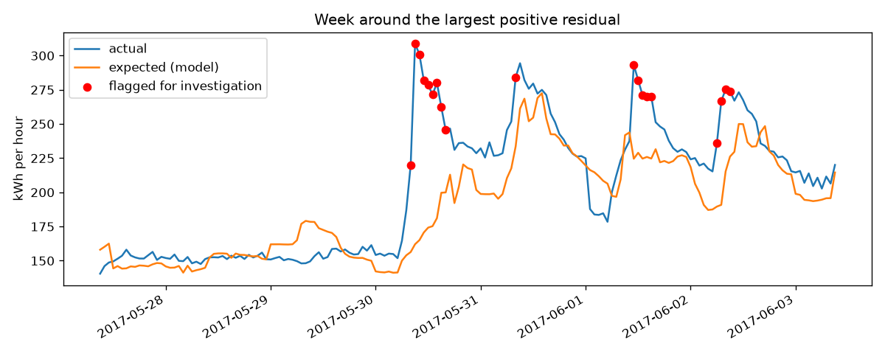

# WATTWISE

**An AI system that learns a building's normal electricity use and flags periods of unexpectedly high consumption that may deserve investigation.**

Veritas AI International High School Hackathon 2026 · Track: AI + Climate
Primary user: a school or building facilities manager

**Research question:** *Can machine learning learn normal building energy-consumption patterns well enough to detect unexpectedly high electricity usage?*

---

## How it works in one picture

```
past usage + calendar + weather ──► ML model ──► expected usage
                                                     │
                       actual meter reading ─────────┤
                                                     ▼
                         residual = actual − expected
                                                     │
                    top 5% of positive residuals ──► "period requiring investigation"
```



## Results (trained on 2016, tested on unseen 2017)

| Method | MAE (kWh) | RMSE (kWh) |
|---|---|---|
| Baseline (2016 average for same weekday + hour) | 44.64 | 52.40 |
| Linear Regression | 13.41 | 20.67 |
| **Random Forest (chosen)** | **11.12** | 17.49 |
| Gradient Boosting | 11.33 | 16.86 |

- The building uses about 196 kWh per hour, so the chosen model is typically off by about 6%.
- **Anomalies:** 228 hours of 2017 were flagged, grouped into 49 periods (threshold: residual ≥ 40.9 kWh, the top 5% of positive residuals).
- **Key finding:** adding "previous hour's usage" makes predictions much more accurate (MAE 4.2), but makes the detector worse at catching *sustained* high usage. We measured this with injected fake spikes. See [docs/ML_EXPLAINED.md §9](docs/ML_EXPLAINED.md).

An anomaly means *usage was unusually high compared with what the model expected*. It does **not** prove energy was wasted.

## Dataset

Hourly electricity of one K-12 school (`Rat_education_Dann`, Washington DC area) from the **Building Data Genome Project 2**, 2016–2017, with site weather. Licensed **CC BY-SA 4.0**. Full details are in [data/DATASET.md](data/DATASET.md).

## Repository structure

```
data/raw/            original hourly data for our building (from BDG2)
data/processed/      cleaned hourly table
data/DATASET.md      source, license, units, cleaning report
ml/get_data.py       (optional) re-download raw data from BDG2
ml/prepare_data.py   step 1: clean data   → data/processed/cleaned.csv, results/data_quality.json
ml/features.py       time, weather and past-usage features (no future data)
ml/train.py          step 2: baseline + 3 models, anomalies, failure analysis, figures
ml/wattwise.py       reusable functions: predict_expected_usage(), analyse_consumption()
model/               saved trained model
results/             metrics.json, predictions.csv, anomalies.csv, failure_analysis.md, figures/
docs/ML_EXPLAINED.md beginner-friendly explanation of everything
notebook/            (for exploration)
website/             (frontend, coming later)
```

## Run it

```bash
python -m venv .venv
.venv\Scripts\activate          # Windows   (macOS/Linux: source .venv/bin/activate)
pip install -r requirements.txt
python ml/prepare_data.py
python ml/train.py
```

Use the trained model on new hourly data:

```python
import sys; sys.path.append("ml")
import pandas as pd
from wattwise import analyse_consumption

df = pd.read_csv("data/processed/cleaned.csv", index_col="timestamp", parse_dates=True)
all_hours, anomalies = analyse_consumption(df["2017-08-01":"2017-09-30"])
```

The input needs hourly `electricity_kwh`, `temperature_c` and `humidity_pct`. The first 7 days are used as history and get no prediction.

## Rules followed

- Only free, local ML (scikit-learn). No paid AI APIs.
- Chronological train/test split; rows are never shuffled.
- Every feature uses only information available before the predicted hour.
- The anomaly threshold comes from the residual distribution, not a hand-picked number.

## Credits

Data: Miller, C. et al. (2020). *The Building Data Genome Project 2.* Scientific Data 7, 368. CC BY-SA 4.0.
